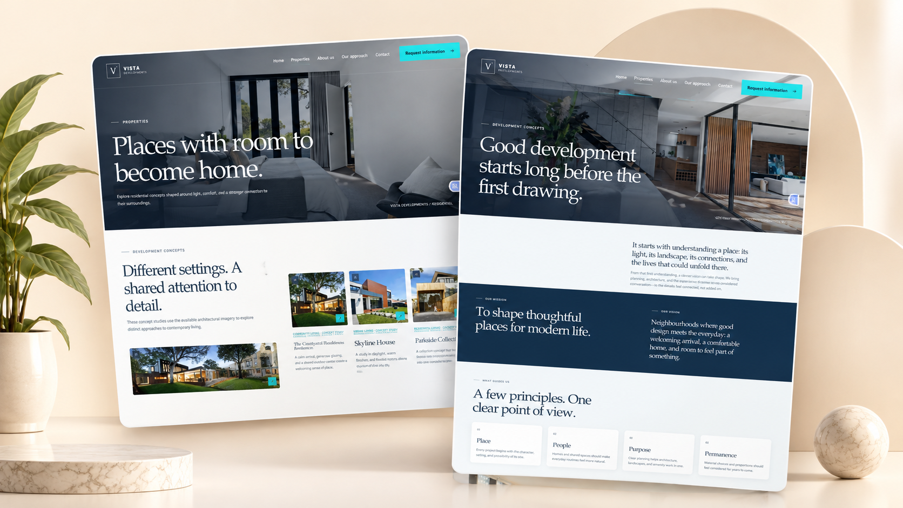

# Busniess-Website

A modern multi-page business website for a property and development brand, built with **React**, **Tailwind CSS**, and **GSAP**. The website combines architectural imagery, refined typography, a clean visual hierarchy, and scroll-driven motion to present the brand and its development concepts.

## Overview

Vista Developments is designed to give a property and development business a polished digital presence. Its visual direction pairs spacious layouts and editorial-style typography with architectural photography, deep navy overlays, and bright cyan accents.

The website brings key business information and property-related content into a clear, easy-to-explore experience. The supplied design showcases areas such as property concepts, the company's approach, its mission and vision, and the principles that guide its work.

## Highlights

- **Four-page website:** A multi-page business website with navigation across the brand's main areas.
- **Scroll-driven hero animation:** The homepage hero visual changes frame by frame as the visitor scrolls, creating a cinematic, interactive introduction.
- **Property and development presentation:** Image-led sections showcase residential spaces and development concepts.
- **Brand and company storytelling:** Dedicated content areas communicate the company's approach, mission, vision, and guiding principles.
- **Clear navigation and calls to action:** Navigation and prominent request-information actions help visitors explore the website and find relevant information.
- **Refined visual direction:** A restrained palette, architectural imagery, elegant typography, and considered spacing create a consistent business-focused identity.

## Technology Stack

### React
Used to build the website's interface with a component-based structure, making page sections and reusable UI elements easier to organize and maintain.

### Tailwind CSS
Used for utility-first styling, layout composition, spacing, typography, and the website's visual system.

### GSAP
Used to create smooth motion and animation effects. On the homepage, the hero imagery is presented as a frame-by-frame sequence that responds to the visitor's scroll position.

## Website Structure

The project contains **four pages**. Together, they present the business, its properties and development concepts, and the information visitors need to understand the brand.

## Design Approach

The design aims to balance a premium architectural feel with straightforward usability:

- Large architectural images establish context and visual impact.
- Deep navy overlays support readable hero text over photography.
- Cyan accents draw attention to important actions and interface details.
- Editorial-style headings and generous whitespace give the content a calm, premium feel.
- Consistent navigation and section layouts help visitors move through the site's content.

## Project Scope

Vista Developments is a business website focused on brand presentation, property and development content, and an engaging front-end experience. This README describes the features and technologies identified for the project; it does not make assumptions about backend services, CMS integrations, forms, or other functionality that has not been specified.
